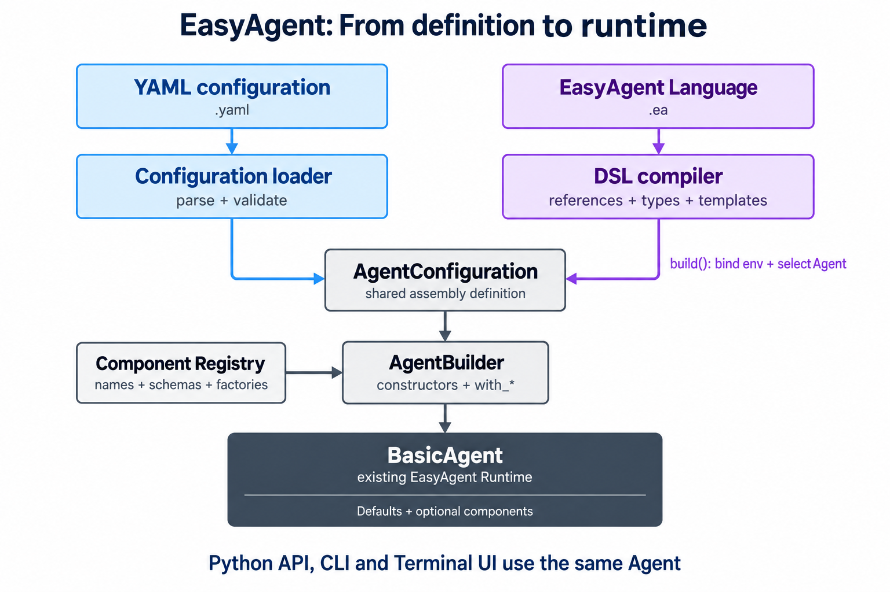

# 从配置到 DSL：EasyAgent 的声明式装配

EasyAgent 现在提供两种无需编写装配代码的入口：**YAML 配置**和 **EasyAgent Language（`.ea`）**。
前者适合快速选择、配置组件；后者增加类型化引用、导入和模板，适合复用自己的 Agent Harness。
两者均已实现可运行初版，原有 Python 用法保持不变。

## 1. 共用装配与运行机制



两条入口最终都得到 `AgentConfiguration`，通过 `AgentBuilder`、已注册工厂和公开
`with_*` 接口装配，返回普通 `BasicAgent`。不会生成 Python 源码，也没有新增 Agent Loop。

DSL 的 `compile_file()` 先返回 `CompiledProgram`；调用 `.build()` 时才选择 Agent、
绑定环境变量并完成构建。CLI、终端 UI 和 Python 调用者继续使用原有 Agent API。

## 2. 目前实现了什么

| 维度 | YAML 配置加载 | `.ea` DSL |
| --- | --- | --- |
| 组件装配 | 选择实现、启用或关闭、填写配置 | 同样支持，使用组件声明和引用 |
| 工具与外部能力 | 工具参数、Skill 目录、MCP Server | 同样支持，不另建管理器 |
| 定义复用 | 当前以单份配置为主 | 命名组件、本地导入、别名、带类型和默认参数的模板 |
| 校验 | 配置结构、实现参数及必要的本地资源 | 额外检查名称、引用类别、参数类型和循环依赖，定位文件与行列 |
| 密钥与路径 | `{env: NAME}`；配置路径相对 YAML 所在目录 | `env()` 延迟绑定；`path()` 相对表达式所在源文件 |
| 启动与查看 | `easyagent-run`、`easyagent-chat` | `easyagent-lang check / explain / run / schema` |

可配置的能力包括 Model、Prompt、Context、Executor、Permission、Memory、Plan、Task、
Session、Observability、Multi-Agent 等。必需组件不能关闭；可选能力按需安装。
**可选能力的底层依赖仍须安装，自定义实现须先由 Python 注册。**

## 3. 同一个 Agent 的两种表达

YAML：直接描述安装哪些能力。

```yaml
version: 1
agent: {name: Assistant}
model:
  provider: openai
  model: your-model
  api_key: {env: OPENAI_API_KEY}
context:
  config: {max_tokens: 32000}
permissions:
  implementation: rule_based
tools:
  - name: filesystem
```

DSL：可以命名、引用组件，并继续提取为带参数的模板。

```ea
model Main {
    provider = "openai"
    model = "your-model"
    api_key = env("OPENAI_API_KEY")
}
context WorkingContext { max_tokens = 32000 }

agent Assistant {
    model = Main
    context = WorkingContext
    permission using rule_based {}
    tools { filesystem() }
}
```

将示例分别保存为 `agent.yaml`、`agent.ea`，修改模型并设置密钥后：

```bash
easyagent-chat agent.yaml       # YAML → Agent → 默认终端 UI
easyagent-lang check agent.ea   # 只做静态检查，无需密钥
easyagent-lang explain agent.ea # 查看装配构成，不展开配置值
easyagent-lang run agent.ea     # DSL → Agent → 默认终端 UI
```

交互界面需安装 `.[ui]`。纯 Python 入口分别是
`load_agent("agent.yaml")` 和 `compile_file("agent.ea").build()`，构建后均可调用
`invoke`、`ainvoke`、`stream`、`astream`，并由调用者管理 Agent 的关闭。

需要生成应用目录时，使用 `buildagent --file agent.yaml --output ./my-agent`，
再执行 `python my-agent/app.py`。它会整理配置和显式资源，并保留同一运行机制；
详见[应用生成指南](application_build.md)。

## 4. 代码如何分工

- [`configuration/`](../configuration/)：安全解析、配置模型、工厂注册与统一装配。
- [`language/`](../language/)：词法/语法解析、引用解析、模板展开、类型与 Schema 检查。
- [`ui/`](../ui/)：输入、流式展示、审批和提问交互；不接管 Agent Loop。
- [`easyagent/configuration.py`](../easyagent/configuration.py)、[`easyagent/language.py`](../easyagent/language.py)：公共入口。

扩展者实现框架接口，再注册“名称 + 配置模型 + 工厂”。YAML 的 `implementation`
和 DSL 的 `using` 都通过同一个注册表选择实现，无需修改语言解析器或 Agent 执行器。
复用组件定义不等于共享实例：每次构建独立的 Agent 和 Runtime；共享外部存储需显式配置。

## 5. 当前边界

`easyagent-run --check` 会解析环境变量并检查本地配置；DSL 的 `check` 只做静态检查，
增加 `--environment` 才检查环境变量和本地资源。两者都不证明模型服务、凭据或 OS 沙箱可用。

当前 DSL 定位是 **Harness 装配语言**，不提供通用循环、任意 Python 执行、远程包管理或完整 LSP。
修改推理循环仍通过自定义 Executor；权限 ASK 仍走既有中断与确认机制，不因声明式启动而自动放行。

继续阅读：[配置加载细节](configuration_loading.md) · [DSL 语法与扩展](language.md) ·
[跨文件模板示例](../example/language/research.ea) · [默认终端 UI](terminal_ui.md)
