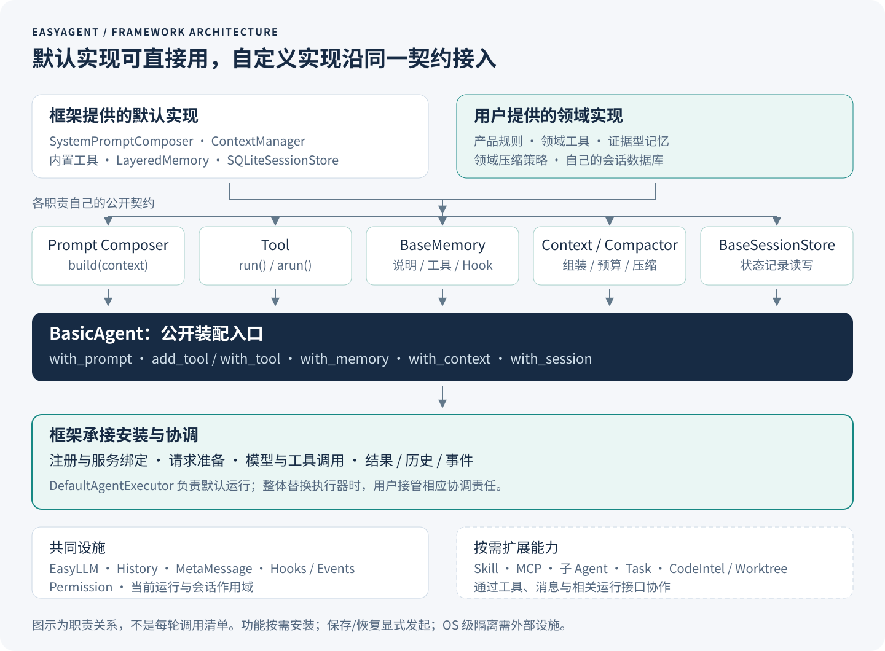
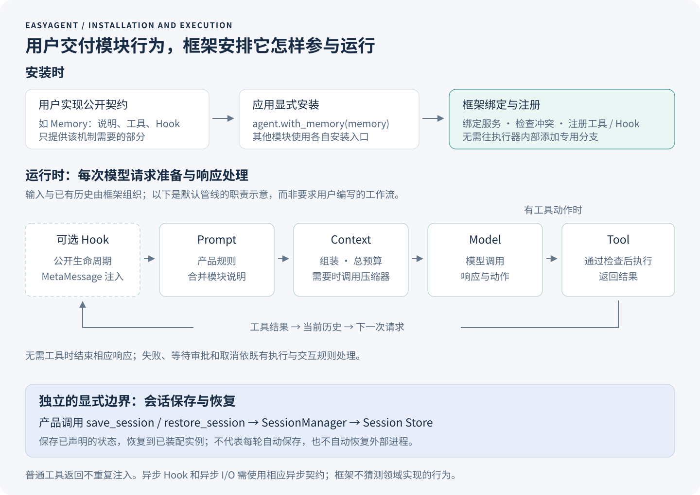
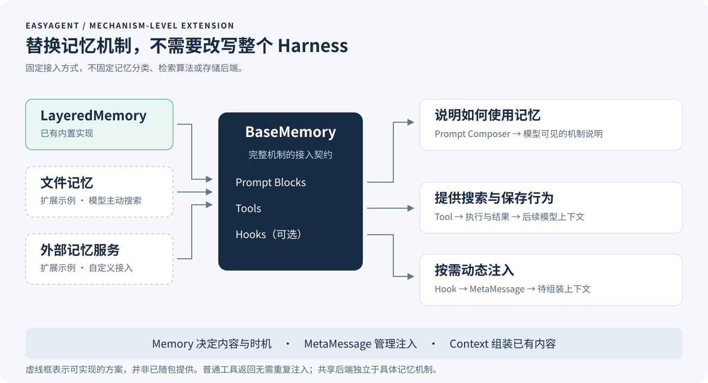

<!-- role: opening / executive summary -->
## 摘要

构建一个领域 Agent，起点往往只是模型、提示词和工具；构建一个能够持续演进的 Agent 产品，则需要处理上下文、工具生命周期、权限、动态信息、记忆、会话和交互。开发者既可以使用通用 Agent 框架组织应用，也可以基于完整 Harness 二次开发。然而，当领域需求涉及运行机制本身时，前者可能留下大量底层协作工作，后者可能要求开发者理解并调整既有产品的内部假设。

EasyAgent 选择面向 Harness 编程：将 Agent 执行、上下文、记忆、工具、权限和会话等运行机制直接作为开发者接口的组织中心。框架提供默认实现，也允许通过对应契约替换关键模块。开发者不需要先掌握整个 Harness 的实现细节，就能使用现成能力；需要定制时，则聚焦自己负责的模块及其行为约定。

本文说明这一设计的动机、框架结构和模块接入机制，以工具、提示词、记忆、压缩和会话存储的扩展示例，展示用户负责什么、框架接管什么，并对照主流应用框架、完整 Harness 产品及模块化 Harness SDK。EasyAgent 的价值主张不是功能数量最多，而是让领域差异尽可能停留在相关模块中，让通用运行机制可以被重复使用。

> **核心主张：默认实现帮助开发者开始，模块契约支持开发者走出默认实现。**

本版本是一份架构与产品定位白皮书，不包含性能实验、开发效率测量或任务成功率排名。EasyAgent 的实现说明以当前 0.8.0 开发工作树为依据；第三方项目以 2026-09-07 查阅的官方资料为依据。文中的选型判断是架构分析，不是对所有版本和场景的绝对结论。

**快速阅读：** 看框架怎样工作，读第 3 章；看自己需要写哪些代码，读第 4 章。比较选型时，先读第 5.1 节的十二维总览，再读第 5.3、6.3、7.2、7.3 节的接口对照和第 8.5 节的修改入口。

## 1. 从“使用 Agent”到“构建自己的 Harness”

<!-- role: opening / problem definition -->
### 1.1 领域化的深度，决定开发方式

若领域化只需修改提示词、添加知识库和注册工具，直接采用已有框架或成熟 Agent 产品通常是合理的选择。EasyAgent 更关注另一类需求：领域差异已经进入 Agent 的运行机制，并将随产品发展持续变化。

例如，一个科研 Agent 不仅需要“懂科研”的提示词。它可能需要按实验组织记忆，让模型主动查找旧结果；长时间等待外部计算任务；在压缩上下文时保留实验条件和证据引用；在恢复会话时识别任务的实际状态。这些需求分别触及记忆、执行、上下文和会话，而不是同一个“提示词配置项”。

运维 Agent 面临不同的约束：诊断操作和变更操作有不同权限，操作目标可能是远端环境，审批记录需要与执行状态关联。数据分析 Agent 则可能需要管理大型结果文件、数据集引用和计算资源。共享的并不是同一套产品流程，而是围绕模型运行的一组机制。

### 1.2 本文所说的 Harness

本文将 Harness 定义为模型周围的执行与状态管理系统：它将用户输入和已有状态组织成模型请求，将模型动作转换为受控工具执行，再把结果送回后续推理，同时处理取消、权限、上下文变化和会话生命周期。

Agent Loop 是其中的协调过程，但 Harness 不止一个循环。一个简短的模型—工具循环可以演示能力，真正的产品还需要明确：工具执行失败是否进入模型上下文，等待审批是否结束当前运行，取消后哪些操作仍可能完成，以及会话恢复能恢复什么、不能恢复什么。

“框架”“SDK”“Harness”并非互斥标签。框架可以内置 Harness，产品可以提供 SDK，SDK 也可以公开可替换的运行模块。本文比较的是开发者实际获得的抽象与扩展边界，而不是项目名称。


*图 1：三种开发入口解决不同问题。图中没有性能排序；各类项目可以跨越多个入口。EasyAgent 将“构建和替换运行机制”作为主要编程入口。*

## 2. 两条常见路线留下的工程成本

<!-- role: challenge / orchestration-first route -->
### 2.1 使用应用框架：自由之外，谁负责运行语义？

以编排为中心的框架擅长描述状态、执行步骤和控制关系。LangGraph 官方定位是面向长期运行、有状态 Agent 的低层编排运行时，允许确定性步骤与模型驱动步骤混合；CrewAI 以 Crews 和 Flows 组织自主协作与执行流程。因此，不能把它们描述为“只能执行预先写死的工作流”。[LangGraph 官方概览][S01]、[CrewAI 官方介绍][S02]

问题出现在抽象与需求不直接对应时。开发者想替换记忆机制，却先要确定该机制怎样更新全局状态；想改变工具结果处理，却同时要考虑节点转移、结果合并和中断恢复。这样的映射本身并非错误，但可能成为额外维护层。

另一项成本来自能力之间的连接。模型、工具、存储和事件即使都已有接口，开发者仍可能要决定它们在失败、取消、审批和恢复时怎样共同工作。组件可复用，不等于组件之间的运行语义已经被复用。某个工具有结果、会话却未保存，和会话保存了“已执行”、外部操作却未完成，是不同的故障。

EasyAgent 的回应是把这些问题直接落到 Harness 的模块边界：执行器协调请求与动作，Context 接受准备好的信息并控制预算，Memory 表达记忆机制，Session 保存和恢复显式状态。产品无需为了这些需求再设计一套与工作流状态相互映射的内部 Harness。

### 2.2 二次开发完整 Harness：开箱即用之后，如何改变机制？

成熟 Harness 的优势是已经装配好了完整运行能力。开发者能够直接使用工具、上下文管理和交互机制，通常比从零建设更快进入业务开发。困难并不是“没有功能”，而是领域需求超出既有扩展点时，修改需要深入到哪里。

配置记忆目录，不一定等同于替换记忆机制；修改压缩提示词，不一定等同于替换压缩算法；在工具前后运行 Hook，不一定等同于接管调度方式。产品 SDK、插件和 Hook 可以覆盖大量实际需求，但“扩展现有行为”和“替换行为机制”仍是不同层次的控制权。

当扩展点不能覆盖需求，开源提供了修改源码的机会，却不自动提供低成本的修改路径。领域团队可能需要理解多个内部组件、维护自己的分支，并在上游更新时重新检查兼容性。这个成本取决于具体产品的模块边界，不能由“是否开源”一项判断。

EasyAgent 的回应是将关键运行机制作为正式契约提供。默认 Agent 是这些能力的使用者和装配入口，而不是所有扩展都必须迁就的唯一产品实现。支持主流方案的意义，也不是让产品继承一切默认策略，而是给用户可用的起点和清晰的替换位置。

### 2.3 需要填补的是抽象缺口，而不是制造对立

应用编排和 Harness 定制可以共存。企业流程负责接单、准备环境、调用领域 Agent、验收及发布；领域 Agent 内部则由模型选择行动，并由 Harness 执行约束。EasyAgent 可以服务于后者，不必同时取代前者。

同样，调用完整 Agent 的程序接口与构建自己的 Agent，都是合理需求。若现成产品已经满足要求，继续复用它通常比重建更合适。EasyAgent 更适合那些把运行机制本身视为产品能力、并希望长期掌握其演进方向的团队。

## 3. EasyAgent 的核心思想：面向 Harness 编程

<!-- role: method / central idea -->
### 3.1 功能模块化：既提供实现，也提供替换位置

EasyAgent 将模型访问、提示词、工具、上下文、记忆、权限和会话等职责组织成模块，并提供默认的工程实现。开发者可以使用默认执行器、提示词组装器、上下文管理器和已有存储，也可以只替换有领域差异的部分。按需安装功能，不意味着要从空白的抽象类集合开始建设整个系统。

默认实现承担了请求准备、工具协议转换、结果处理、事件发布和状态管理等共同工作；模块契约则限定用户自定义实现需要交付什么。框架“提供某项实现”与 Agent “默认启用所有功能”并不相同，例如 Memory、工具和压缩策略仍由应用按需安装。[公开 API 指南][E05]



*图 2：EasyAgent 框架图。默认实现与自定义实现遵循各职责的公开契约；BasicAgent 负责显式装配，默认执行管线在相应位置使用已安装能力。图中的辅助能力复用相关模块，不表示所有模块使用同一个万能接口，也不表示全部默认启用。*

### 3.2 同一职责契约，允许不同实现机制

功能模块化的关键不是把代码分到几个目录，而是让默认实现和用户实现具有明确的替代关系。产品要改变记忆参与方式，就实现 Memory 契约；要改变历史保留策略，就替换压缩器；要改变会话存储，就实现 Session Store。需求与代码责任直接对应，不必先转译成另一套流程节点。

不同职责不应被强行统一为同一种内部模型。记忆可以通过工具让模型主动搜索，也可以选择用 Hook 注入信息；上下文负责组装准备好的内容，不替各个来源决定检索方式；会话存储保存框架提供的状态记录，不决定如何构造产品 Agent。各模块按自身职责设计接口，而不是都继承一个规定所有行为的 `BaseModule`。

这使机制替换与后端替换成为不同操作。替换向量数据库，不等于改变记忆如何参与推理；实现一个不同的记忆机制，也不应该迫使用户重写模型调用和上下文管线。

### 3.3 框架接管接入过程：实现功能，不手工连接循环

模块作者提供契约要求的行为，应用通过公开入口安装模块，框架负责将其接入相应能力。以 `with_memory()` 为例：安装时绑定模块可使用的服务，读取并注册该模块提供的工具和 Hook，检查冲突；运行时，提示词组装器按需取得模块说明，工具执行路径处理其工具，Hook 在公开生命周期位置被调用。用户不需要在执行器内部增加一个“如果是我的记忆系统”的分支。[记忆模块指南][E01]

并非所有模块都在同一时机被调用。提示词在请求准备时构建，工具在模型提出相应动作后执行，压缩器在配置的上下文管线需要压缩时参与；会话保存和恢复由产品显式发起，不意味着框架每轮自动保存。公开契约把这些时机说清楚，用户无需掌握实现这些时机的内部调用链。



*图 3：安装与运行分开。虚线表示可选能力；正常工具结果进入历史并供后续请求使用，不需要重复注入。会话操作处于显式的产品生命周期边界。图示为默认执行管线的职责流程，不是工作流图 API，也不是用户需要手写的调用链。*

### 3.4 封装系统知识，不隐藏必要责任

使用默认实现的人主要理解配置和装配；实现某个模块的人主要理解该模块的输入、输出和生命周期；确实要改变整个执行策略的人，才需要接管更广的协调责任。**用户不必理解其他模块怎样实现，也不必亲自把自己的实现连接到每一种 Agent 调用方式。**

抽象并不替用户决定领域逻辑。工具作者仍要说明副作用，自定义存储仍要处理数据一致性，异步 I/O 仍需相应异步方法。知道 `abefore_context` 是公开调用时机，与研究同步、异步、流式执行器如何实现这套时序，是不同的知识负担。框架隐藏无关细节，但不能隐瞒这些行为约定。

### 3.5 从默认能力到深度定制，逐层增加控制

第一层是直接使用：安装 `LayeredMemory`、配置 `ContextManager` 或选择已有 Session Store。第二层是替换局部实现：提供自己的 Prompt Composer、Tool、Memory、压缩器或存储后端。第三层是替换执行器：只有循环策略本身发生变化时，才承担请求、工具、事件和状态之间的协调。

EasyAgent 因而既不是要求每个人从零编写 Harness，也不是只允许围绕一个固定 Agent 调整参数。它的结构优势是机制可选、变化有局部落点、基础设施可共享、产品装配可自主控制。当前尚未覆盖的统一执行环境、细粒度调度等边界仍以第 9 章为准，不将架构图视为所有功能已经完成的清单。

## 4. 从理念到实现：通过模块接口构建领域 Harness

<!-- role: method / developer contract -->
### 4.1 统一的扩展路径，不是统一的万能接口

一次常见扩展可以概括为：明确领域差异，找到对应公开契约，实现需要的方法，再通过 Agent 的公开入口安装。之后仍使用普通的 `invoke`、`ainvoke` 或流式入口，默认执行管线负责在正确位置调用已安装模块。用户不需要为每个模块复制一套工具循环。

接口分工表：用户实现的是模块行为，框架负责的是该行为在默认运行方式中的接入。

| 模块 | 用户实现或提供 | 框架承接的共同工作 |
| --- | --- | --- |
| Tool | 参数模型、动作逻辑和结果 | 工具描述导出、校验、执行路径、结果与事件 |
| Prompt Composer | 产品规则和 Prompt Blocks | 请求时调用、模块说明合并和请求编译 |
| Memory | 机制说明、工具、可选 Hook | 服务绑定、工具/Hook 注册及运行时调用 |
| History Compactor | 对给定历史片段的压缩策略 | 预算预检、调用压缩器、组装候选历史与最终检查 |
| Session Store | 状态记录的保存与读取等操作 | 收集约定状态、维护会话操作、恢复到已装配实例 |

以下示例围绕“证据型研究 Agent”展开，重点展示扩展契约，不是完整科研产品。仓库、摘要函数和数据库由应用提供，代码不伪造这些领域实现。示例可按顺序组合；安装方式以公开 API 表达，不调用框架私有方法。

### 4.2 自定义工具：不用编写模型—工具循环

**需求与接口。** 用户希望模型按证据 ID 查阅记录，只需定义参数并实现 `Tool.run()`。下面假定 `repository.lookup(id)` 返回含 `text` 等字段的字典，或在记录不存在时返回 `None`。

```python
from pydantic import BaseModel, Field
from easyagent.tools import Tool, ToolResult

class EvidenceQuery(BaseModel):
    evidence_id: str = Field(min_length=1, description="Stable evidence ID")

class LookupEvidence(Tool):
    def __init__(self, repository):
        self.repository = repository
        super().__init__(
            name="lookup_evidence", description="Read a known evidence record.",
            parameters=EvidenceQuery, read_only=True,
        )

    def run(self, parameters):
        record = self.repository.lookup(parameters["evidence_id"])
        if record is None:
            return ToolResult.error("Evidence not found", error_type="not_found")
        return ToolResult.success(record["text"], structured_data=record)

# 安装：agent.add_tool(LookupEvidence(repository))
```

**用户写什么。** 参数含义、仓库查询、结果内容和错误语义属于工具作者。已有文件、Shell 或 MCP 工具可以直接使用；只在领域动作不同的时候编写自己的 Tool。

**框架接管什么。** 沿正常 Agent 执行路径，框架提供工具描述、参数校验，经过权限和 Hook 等检查后执行动作，并处理结果、历史与事件。用户不必解析模型的原始工具调用，也不必手动把结果送回下一轮请求。直接调用 `tool.run()` 是低层调用，不会自动经过完整 Agent 管线。

**仍需遵守什么。** 此例是轻量同步读取；若访问远端服务，应提供适当的 `arun()`，而不是假定同步 I/O 自动变成非阻塞操作。只读和副作用声明必须与真实行为一致。[工具编写指南][E08]

### 4.3 自定义提示词：只写产品规则，不写请求编译

**需求与接口。** 用户希望研究 Agent 遵守证据引用规则，并在每次请求看到当前工作区。通常只需实现 `BaseSystemPromptComposer.build()`，返回 Prompt Blocks，而不是重写完整的 `compose()`。

```python
from easyagent.prompting import BaseSystemPromptComposer, PromptBlock

class ResearchPrompt(BaseSystemPromptComposer):
    def build(self, context):
        return [
            PromptBlock("identity", "You are an evidence-based research assistant."),
            PromptBlock("evidence-rule", "Distinguish verified evidence from hypotheses."),
            PromptBlock(
                "workspace", f"Workspace: {context.execution_context.workspace_root}",
                placement="system_reminder",
            ),
        ]

# 安装：agent.with_prompt(ResearchPrompt())
```

**用户写什么。** 内容、placement 与对公开 `PromptBuildContext` 的使用。只需要固定内容时，也可以直接配置默认 `SystemPromptComposer`，无需创建子类。

**框架接管什么。** 每次准备请求时调用组装器；基类的 `compose()` 会在启用模块说明时合并 Memory 的 Prompt Blocks，再由请求编译路径处理 system 与 system reminder。用户无需研究各 provider 的消息格式，也不必在自定义身份提示词后再手工拼接记忆说明。

**仍需遵守什么。** 本例没有开启默认通用提示词规则，但保留基类的模块说明合并。如果用户覆盖 `compose()` 或主动关闭模块说明，就要对相应变化负责。“重写产品提示词”与“丢弃所有模块说明”不是同一个操作。[提示词接口说明][E09]

### 4.4 自定义记忆：实现机制，不实现它与循环的连接

**需求与接口。** 研究 Agent 需要主动查找和保存证据，而不是每轮自动召回。`BaseMemory` 允许模块提供说明和工具，不要求统一 CRUD、记忆分类或向量后端。下面的工具列表由应用提供，可以含搜索、读取和保存工具。

```python
from easyagent.memory import BaseMemory
from easyagent.prompting import PromptBlock

class EvidenceMemory(BaseMemory):
    def __init__(self, retrieval_tools=(), persistence_tools=()):
        self.retrieval_tools = list(retrieval_tools)
        self.persistence_tools = list(persistence_tools)

    def get_prompt_blocks(self, context):
        return [PromptBlock(
            "memory.evidence",
            "Use the evidence tools when prior findings are relevant. "
            "Save reusable findings with their source references.",
        )]

    def get_retrieval_tools(self):
        return self.retrieval_tools

    def get_persistence_tools(self):
        return self.persistence_tools

# 安装：agent.with_memory(EvidenceMemory(memory_tools))
```

**用户写什么。** 记忆机制怎样向模型说明、暴露哪些工具，以及这些工具如何读写自己的数据。若既有分层方案适用，可以直接安装 `LayeredMemory`，无需理解或重写其内部层次。

**框架接管什么。** `with_memory()` 绑定 MemoryServices，检查并注册工具，将 `get_hooks()` 返回的 Hook 接入管理器。后续提示词组装取得记忆说明，模型提出工具动作时沿普通工具路径执行。因此，Memory 作者不必改执行器，不必修改 Context 的来源列表，也不必分别连接同步和异步调用。



*图 4：固定的是接入契约，不是检索算法。动态注入是可选路径；普通工具结果走已有工具返回路径，不需要再复制为 MetaMessage。文件方案和外部服务是扩展示意。*

**可选动态参与。** 某些记忆方案确实需要请求前检索，可以实现公开 Hook，而不是把查询逻辑插进 Agent 私有循环。例如下列 Hook 由该 Memory 的 `get_hooks()` 返回，`client.recall()` 是应用提供的异步服务。

```python
from easyagent.hooks import BaseHook
from easyagent.metamessages import MetaMessage, MetaMessageLifecycle

class RecallBeforeContext(BaseHook):
    def __init__(self, memory, client):
        self.memory, self.client = memory, client

    async def abefore_context(self, payload):
        note = await self.client.recall(payload["query"])
        if note:
            self.memory.services.metamessages.emit(MetaMessage(
                name="evidence-recall", content=note,
                lifecycle=MetaMessageLifecycle.REQUEST,
                metadata={"source": "memory.evidence"},
            ))
```

此路径使用 `ainvoke` 或 `astream`，让框架等待异步 Hook；不需要自动检索的方案完全可以不提供它。Memory 决定内容、时机和来源，MetaMessage 处理注入与生命周期，Context 组装准备好的内容。工具返回已经是观察结果时，不应重复注入。

**仍需遵守什么。** 一个已绑定的有状态 Memory 实例不应同时给多个 Agent 使用；是否关闭外部资源由所有权约定决定。自定义状态若需要保存，也应实现相应状态导出/恢复方法。文件记忆和外部服务在此是扩展方向，不表示框架已提供所有完整产品实现。[记忆模块指南][E01]

### 4.5 自定义压缩器：只定义领域保留策略

**需求与接口。** 用户希望摘要保留证据引用、实验条件和未解决问题。若组装方式不变，通常只需实现 `BaseHistoryCompactor.compact()`，而不必替换完整 Context。下面将领域摘要交给调用方提供的 `summarize` 函数。

```python
from easyagent.context import BaseHistoryCompactor, ContextManager
from easyagent.history import CanonicalMessage

class EvidenceCompactor(BaseHistoryCompactor):
    recent_turns = 2

    def __init__(self, summarize):
        super().__init__()
        self.summarize = summarize

    def compact(self, history):
        summary = self.summarize(history or [])
        return [CanonicalMessage(
            role="user", content=[{"type": "text", "text": summary}],
        )]

def make_context(summarize):
    context = ContextManager(max_tokens=24_000)
    context.set_history_compactor(EvidenceCompactor(summarize))
    return context

# 安装：agent.with_context(make_context(summarize))
```

**用户写什么。** 摘要策略及其输出消息。`compact()` 接收的是 Context 决定交给它处理的历史片段，不应假定始终得到完整会话；默认管理器另行处理保留的近期轮次。

**框架接管什么。** 默认管线组装候选请求、检查预算、调用已配置压缩器、重组历史，并在发送前作最终预算检查。用户不用自己在每一轮调用前插入计数与压缩分支。当前用量机制还统一处理有效 API usage 基线与本地增量估算；自定义压缩器不必重新实现它。

**仍需遵守什么。** 摘要不能杜撰证据或破坏消息语义。框架保留预算检查和默认管理器的失败处理，不保证任意用户实现都能压缩到预算内。若需要改变组装机制本身，再实现 `BaseContextManager`；若摘要服务是原生异步，应提供相应 `acompact()`。[Context 与压缩指南][E02]

### 4.6 自定义会话存储：保存记录，不重建 Agent

**需求与接口。** 用户希望将会话放入自己的数据库。`BaseSessionStore` 接收框架组织好的快照及元数据，存储作者不需要逐个访问 Agent 内部模块。下面只展示保存与读取这两个操作；`repository` 是应用自己的数据库访问层。

```python
from easyagent.session import BaseSessionStore

class DomainSessionStore(BaseSessionStore):
    def __init__(self, repository):
        self.repository = repository

    def create_or_update_session(
        self, session_id, agent_type, agent_name, snapshot,
        metadata=None, expires_at=None, *, expected_revision=None,
    ):
        return self.repository.write_session(
            session_id=session_id, agent_type=agent_type, agent_name=agent_name,
            snapshot=snapshot, metadata=metadata, expires_at=expires_at,
            expected_revision=expected_revision,
        )

    def get_session(self, session_id, touch=False):
        return self.repository.read_session(session_id, touch=touch)

# 安装：agent.with_session(DomainSessionStore(repository))
```

**用户写什么。** 数据读写、并发版本检查和返回记录格式。数据库访问层必须履行 Store 的记录契约，包括 `snapshot`、`revision`、`metadata` 等字段；未知记录返回 `None`。列表、删除及清理等方法按应用需求继续实现，此例不是一个完整生产数据库后端。已有 SQLite 或内存实现适用时，可以直接使用，不写这段接入代码。

**框架接管什么。** SessionManager 从当前历史和约定的状态参与者中收集可序列化数据，调用 Store 保存，并在恢复时检查格式，将数据交给已装配实例的状态恢复路径。用户不需要在 Store 中构建 Agent、初始化模型，或为每个模块重新编写一套恢复流程。

**仍需遵守什么。** 保存与恢复由产品显式发起，框架不保证每轮自动保存。数据库必须原子地处理 `expected_revision`；异步后端需提供对应异步方法。会话快照不是完整原始日志，也不意味着重放或恢复外部进程。Memory 和 RAG 需要共享文档、向量或图后端时，可以使用独立的 Storage 契约，而不是把这些数据混入会话实例装配。[会话指南][E03]、[公共存储指南][E04]

### 4.7 将模块装配成产品，而不是再次编写 Harness

下面把本章定义的类装配起来。`repository` 用于证据读取，`memory_tools` 为另外提供的记忆工具，`summarize` 为领域摘要函数，`session_store` 可以是已有实现或上面的自定义实现。工具名称应互不冲突。

```python
from easyagent import BasicAgent

def build_research_agent(llm, repository, memory_tools, summarize, session_store):
    agent = BasicAgent("research-agent", llm)
    agent.with_prompt(ResearchPrompt())
    agent.add_tool(LookupEvidence(repository))
    agent.with_memory(EvidenceMemory(memory_tools))
    agent.with_context(make_context(summarize))
    agent.with_session(session_store)
    return agent
```

应用之后仍调用普通 Agent 接口。保存时使用 `save_session()`；恢复时先用同一装配函数创建所需实例，再调用 `restore_session()`。本章并没有让用户手动调用提示词编译、模型工具协议解析、记忆注册或历史恢复的内部实现。

这不是消除领域工程，而是改变工程边界：**用户实现自己模块的逻辑，框架处理模块如何参与默认 Agent 运行。** 若整个循环策略需要变化，仍可替换 Executor；但那属于更深的控制层，不是增加工具、改变提示词或接入记忆的前提。

## 5. 与主流 Agent 框架对比

<!-- role: evidence / comparison methodology -->
本节比较各项目的主要编程入口、已公开的能力与 EasyAgent 的相关取向，不将“文档未强调”写成“不支持”。所有项目都可能通过组合、扩展或改源码实现更多功能；差别在于开发者要接触什么契约，以及需求是否能沿正式扩展路径完成。每行最后一列是本文的架构判断，不是测量结果。

### 5.1 十二个维度：比较的是编程边界

下表概括两种常见的**使用路线**，不是给所有项目贴互斥标签。应用框架可以提供 Harness，完整产品也可以公开模块接口；中间的模块化方案在第 7 节单独比较。EasyAgent 一列描述当前接口及其设计取向，不是效果评分。

表 1：十二维定位总览。列描述使用入口，行描述开发者需要控制的对象。

| 维度 | EasyAgent：面向 Harness 的模块编程 | 以应用／编排为入口 | 以完整 Harness 集成为入口 |
| --- | --- | --- | --- |
| D01 编程模型 | 执行器、Context、Memory、Session 等职责契约 | 节点、事件、Agent、任务与运行状态 | 产品客户端、会话与产品配置 |
| D02 循环控制权 | 默认执行器可用，也可整体替换 | 图、Runner 或 Agent 实现控制循环 | 产品运行时控制循环，外部发起和干预运行 |
| D03 模块替换粒度 | 关键机制有独立契约，不止参数开关 | 通过组件、节点、中间件等扩展 | 通过产品开放的配置、Hook、插件或内部代码 |
| D04 提示词与动态注入 | Prompt Composer 与 MetaMessage 分工 | 请求前处理、状态或中间件 | 产品指令、上下文入口及 Hook |
| D05 上下文与压缩 | Context 总预算，压缩器可替换 | 消息变换、节点或内置上下文策略 | 复用产品策略，在公开范围内定制 |
| D06 记忆机制 | 可选说明、工具和 Hook，不强制召回流程 | Memory、Store、工具或应用状态 | 产品记忆约定，或自定义工具与插件 |
| D07 存储复用 | Session Store 与领域中立 Storage 分开 | 状态持久化、记忆后端与数据组件 | 产品存储接口或源码中的服务边界 |
| D08 工具与协议 | Tool／Registry、MCP 等能力供产品装配 | 函数工具、组件工具、MCP 等 | 产品内置工具加扩展工具 |
| D09 权限与隔离 | Permission 做决策；隔离设施另行接入 | 审批／Guardrails 与部署环境组合 | 采用产品权限、审批及沙箱设施 |
| D10 会话与恢复 | 装配后恢复状态，快照不等于完整日志 | Checkpointer、Session 或工作流恢复 | 恢复、fork、回溯以产品公开语义为准 |
| D11 流式、取消与事件 | 同步／异步／流式入口及运行事件 | 流、回调、事件与运行状态接口 | SDK／协议转发运行事件和控制请求 |
| D12 产品集成与学习边界 | 默认组合即可使用；定制时理解相关契约 | 理解应用模型及需求对应的运行接口 | 简单集成学习 SDK；深度改造可能进入产品内部 |

表 1 的价值不是把某一列全部判为“更好”，而是明确控制权放在哪里。EasyAgent 的优势主要落在 D03、D06、D07、D10：机制级接口、记忆与存储分离、装配与恢复分离；D09 的统一执行隔离和 D12 的实际学习成本则不能当作已经全面领先的结论。

### 5.2 应用、编排与通用 Agent 开发框架

表 2：主流框架的主要入口与适用取向。详细机制不能仅由本表的项目分类推断。

| 项目 | 主要入口与已公开能力 | 与 EasyAgent 的关键对照 |
| --- | --- | --- |
| [LangChain / LangGraph][S01] | 模型、工具与 Agent 组件；图状态、持久执行、流式和人工介入 | 适合应用与执行编排。EasyAgent 把 Harness 模块契约作为主要入口，不要求先用图描述内部机制；外层流程可以继续使用图。 |
| [CrewAI][S02] | Agent、Task、Crew、Flow；自主协作与有状态流程 | 角色与任务分工清晰。EasyAgent 优先表达一个 Agent 的运行组成，而不要求先组织成团队任务。 |
| [OpenAI Agents SDK][S03] | Agent、Runner、Tools、Handoffs、Guardrails、会话与运行状态 | 已提供循环和运行能力，并非仅做编排。应比较具体模块的替换边界，而不能声称它没有 Harness。 |
| [Google ADK][S05] | Agent 开发、模型和工具接入、调试部署与图式工作流 | 覆盖从 Agent 到应用部署的需求。EasyAgent 侧重按运行机制划分的 Python 模块装配；并不声称 ADK 只能使用 Google 模型。 |
| [Microsoft Agent Framework][S06] | Agent 与多 Agent 模式、工作流、会话状态、中间件和遥测 | 企业集成与工作流是重要组成。EasyAgent 的取向是以领域 Harness 的局部定制作为设计中心，而非取代其企业生态。 |
| [smolagents][S07] | 轻量 Agent；CodeAgent 通过代码表达工具行动，支持沙箱执行 | 它也不是图编排框架。比较重点是轻量行动模型与较完整的模块、状态和产品装配需求，不是“模型能否自主行动”。 |
| [LlamaIndex Workflows][S08] | 由事件触发的步骤、类型化事件和执行流 | 适合将应用逻辑表达为事件驱动工作流。EasyAgent 针对的是工作流内部的 Agent 运行机制；二者可处于不同层次。 |
| [Haystack][S09] | 组件与 Pipeline；Agent 管理工具循环、共享状态、流式和人工审核 | 检索与组件复用具有直接价值。EasyAgent 不替代检索 Pipeline，而允许检索工具或模块接入自身 Harness。 |

Microsoft 官方将 Agent Framework 描述为 AutoGen 与 Semantic Kernel 的后续方向，因此这里按这一谱系比较，而不是把旧项目当成静止不变的竞争对象。[Microsoft 官方概览][S06]

OpenAI Agents SDK 的 Sandbox Agent 已公开文件、Shell、记忆和压缩等能力组合，开发者也能切换执行环境。因此，EasyAgent 的差异不能建立在“其他 SDK 没有环境、记忆或压缩”之上，而应落在契约粒度、实现替换路径和产品独立性上。[Sandbox Agents][S04]

### 5.3 记忆、上下文和持久化：具体接口横向对照

表 3：四种实际开发入口的机制对照。格内记录公开接口或责任位置；“未核对”只表示本版资料覆盖不足，不表示不支持。

| 维度 | EasyAgent | LangGraph | CrewAI | OpenAI Agents SDK |
| --- | --- | --- | --- | --- |
| 记忆的表达对象 | `BaseMemory` 提供说明、工具、Hook | 状态、长期 Store 与自定义逻辑 | `Memory` 的保存、召回与记忆记录 | Session 管理对话；Sandbox Memory 提供记忆能力 |
| 检索由谁触发 | 记忆实现选择模型工具或 Hook | 应用定义查询与调用位置 | 默认 Crew 路径按任务召回；也可独立调用 | Sandbox 记忆支持模型读取；其他方案由应用接入 |
| 上下文压缩入口 | 压缩器或完整 Context 契约 | 裁剪、删除、总结消息及自定义策略 | 可配置自动摘要；独立压缩契约未核对 | Sandbox Compaction 能力；细节依具体运行路径 |
| 会话／状态保存 | SessionManager + Store 契约 | Checkpointer 保存执行状态 | Flow 状态与 Memory 后端是不同对象 | SDK Session 与可恢复运行状态 |
| 存储与机制关系 | 公共 Storage 不规定记忆记录形状 | Checkpointer 与长期 Store 分工 | 可实现 `StorageBackend` 替换记忆后端 | 应用可控制存储；Sandbox 环境另有状态 |
| 定制时主要理解 | 相关模块契约与协作责任 | 图状态、消息及持久化语义 | Agent／Crew／Flow 与 Memory 语义 | Agent／Runner、Session 与能力生命周期 |

依据：[LangGraph Memory][S20]、[CrewAI Memory][S21]、[CrewAI Agent 参数][S26]、[Agents SDK][S03]、[Sandbox Agents][S04]，以及 EasyAgent 的 [Memory][E01]、[Context][E02]、[Session][E03]、[Storage][E04] 指南。

这个比较揭示了一个重要区别：CrewAI 已公开记忆后端替换方式，LangGraph 也提供多种历史处理与持久化路径。EasyAgent 要强调的不是“只有我能换数据库”，而是 `BaseMemory` 不要求用户先接受一种记忆记录与召回机制；底层存储的替换和整个记忆机制的替换分别有自己的位置。

### 5.4 面对这些框架，EasyAgent 补什么

EasyAgent 首先补的是一套以 Harness 机制为中心的组织方式：用户可以直接讨论记忆、上下文和会话接口，而不是每次重新决定这些概念怎样映射到应用状态。其次，它将默认运行与模块装配放在一起，避免只交给用户孤立组件。最后，它提供从默认实现到自定义机制的连续路径，降低进入整个系统内部的必要性。

这些是设计层面的价值，不代表其他项目无法实现同样目标。团队若已深度依赖某个生态，应同时评估复用既有部署、观测和工作流设施的收益。为保持产品可控而引入 EasyAgent，与为追求统一技术栈而沿用原框架，都是可以成立的工程选择。

## 6. 与完整 Harness 产品对比

<!-- role: evidence / product harnesses -->
### 6.1 从“驱动已有 Agent”到“构建自己的机制”

表 4：完整 Harness 的产品集成入口，不将产品目标误当作框架能力缺陷。

| 项目或产品接口 | 已公开的集成方式与优势 | 深度领域化时应检查什么 |
| --- | --- | --- |
| [Codex App Server][S10] | 通过结构化协议集成认证、会话、审批和流式事件，可构建自己的客户端 | 需要的是运行 Codex，还是替换其内部机制？产品操作接口不自动等同于任意模块替换接口。 |
| [Claude Code / Claude Agent SDK][S11] | 复用 Claude Code 的工具、Agent Loop 和上下文管理；提供提示词、工具、Hook 等扩展 | 需求是否能通过正式扩展点完成？修改默认行为和接管机制是不同层次，但不能因此说 SDK 不支持定制。 |
| [Gemini CLI][S12] | 开源终端 Agent，提供工具及扩展能力，可结合其源码与文档构建集成 | 终端与产品配置假设是否符合目标领域？若要改核心机制，需核查当前版本的公共边界。 |
| [OpenCode SDK][S13] | 类型化 JS/TS 客户端，程序化访问服务、会话、文件和事件 | 服务客户端擅长集成已有运行时；客户端可操作的范围与内部模块可替换范围需要分别评估。 |
| [Aider][S14] | 面向代码库的交互式编辑，文件上下文与 Git 工作方式紧密结合 | 若目标不是代码编辑，需要明确哪些交互和状态假设仍适用。不能把它的产品目标视为一般框架缺陷。 |

对这类产品，EasyAgent 的吸引力不是“也能执行任务”，而是开发者能保留自己对 Harness 机制的定义权。工具、记忆、上下文和会话的公共契约，不应依赖某个终端产品的命令、目录习惯或完成任务方式。

一个产品可以基于 EasyAgent 构建自己的 Core，再向外提供 CLI、TUI、SDK 和无界面服务。外部程序使用产品 SDK；产品的内部界面与 SDK 则共同消费 Core。这样的分层使“产品可被调用”与“产品依赖什么框架”分开，也避免把 EasyAgent 的内部类型直接变成所有外部用户必须理解的 API。

### 6.2 S4Code：框架与产品分离的具体落点

S4Code 在这个工作空间中是基于 EasyAgent 的具体 Coding Agent 产品。`S4CodeAgent` 属于产品 Core 的一个组成部分，而不是整个 Core；配置、运行、会话和工具装配共同形成产品核心。Python SDK、CLI、Textual TUI 与桥接服务是产品核心的消费者，Ink TUI 经桥接访问同一 Core。


*图 5：框架之外的产品分工。领域产品 Core 负责产品装配和规则，CLI、TUI、SDK 是平级消费者。与第 3 章框架内部图不同，本图说明这些能力怎样组成面向用户的产品。执行隔离仍需相应外部设施。*

这一案例说明 EasyAgent 可以承载产品构建，但不将 S4Code 的全部行为下沉为框架规则。提示词身份、斜杠命令、界面 checkpoint 交互以及主题等由产品相应层负责；可复用的模型、工具、上下文和状态能力属于框架。S4Code 是具体案例，不是多个领域迁移效果已经被测量的证据。[产品边界说明][E06]

### 6.3 对照成熟产品：运行接口与构建接口

表 5：EasyAgent 与两种代表性产品接口的控制边界。比较对象是所列公开入口，不是源码可修改性的极限。

| 维度 | EasyAgent | Codex App Server | Claude Agent SDK |
| --- | --- | --- | --- |
| 开发者直接操作 | 自己的 Agent 和运行模块 | 产品 thread、turn、item 与请求 | SDK 运行、消息、工具和配置 |
| 谁提供默认循环 | EasyAgent 默认执行器 | Codex 运行时 | Claude Code 共用的运行时 |
| 如何改变核心行为 | 替换对应模块；必要时替换执行器 | 先使用协议和产品扩展点；更深机制逐项核查 | 提示词、工具、Hook 等扩展；更深机制逐项核查 |
| 压缩控制入口 | 可实现压缩器或 Context | `thread/compact/start` 发起产品压缩 | 自动压缩、总结指令、`PreCompact` 等 |
| 动态上下文 | 模块经 MetaMessage 或工具结果参与 | 通过产品的消息与工具入口 | 通过 SDK 输入、工具与 Hook |
| 会话与分支 | Store 契约、恢复与 fork；不是完整归档 | thread 恢复、fork、回溯等产品操作 | SDK 的会话管理能力，遵循产品状态语义 |
| 审批与交互 | 框架做权限判断，产品实现交互入口 | 服务请求审批，客户端返回决定 | SDK 提供审批与行为控制接口 |
| 自建 UI／外部 API | 产品 Core 自行提供，S4Code 是案例 | 已有协议适合构建独立客户端 | SDK 适合嵌入自己的应用 |

依据：[Codex App Server][S10]、[Claude Agent SDK][S11]、[Claude Agent Loop 与压缩][S25]。能发起压缩，不等同于已经公开替换任意压缩算法的构建契约；反过来，使用构建契约也意味着产品团队要承担更多装配责任。EasyAgent 的价值是把这份责任划分清楚，而不是把它全部消除。

## 7. 与模块化 Harness SDK 的正面对照

<!-- role: evidence / closest alternatives -->
最接近 EasyAgent 的并不只有编排框架，也包括已经将 Harness 做成可复用库的项目。下面这些方案承认并解决了相同问题的一部分。将它们忽略，或仅称为“不能扩展的成品”，会削弱比较的可信度。

### 7.1 最接近的比较对象

表 6：模块化 Harness SDK 总览。下两张表进一步对照具体机制。

| 项目 | 官方公开的模块化方式 | EasyAgent 应坚持比较的具体边界 |
| --- | --- | --- |
| [Deep Agents][S15] | 基于 LangChain / LangGraph 的 Harness；文件系统、上下文、子 Agent、人工介入及可接入后端 | 不以“有没有 Harness”为差别；比较替换完整机制时依赖的接口，以及开发者需掌握的运行模型。 |
| [Pydantic AI Harness][S16] | 以 Capability 组合指令、工具与行为；完整 Coder 也可拆成组成能力 | 模块化本身不是 EasyAgent 独有。重点比较 Memory、Context、Session 的独立领域契约，与统一能力组合方式各自的使用成本。 |
| [OpenHands Software Agent SDK][S17] | Agent、Conversation、Tools、Workspace、Condenser、Security；支持本地及远程运行 | 已有相当直接的运行时抽象。应比较契约、状态责任和产品装配方式，不笼统声称它只有产品、没有框架。 |
| [Cline SDK][S18] | 将模型层、无状态 Agent 循环和有状态 Core 分层，公开运行与扩展边界 | 同样体现产品运行时可复用化。EasyAgent 的特色需由自己的模块语义和扩展示例呈现，而非仅凭“Core 解耦”。 |

EasyAgent 的设计辨识度来自一组明确选择：将记忆机制与存储后端分开，将动态注入与内容来源分开，将上下文组装与检索策略分开，将会话数据与产品实例装配分开，并将执行器作为可替换的协调点。这些选择一起形成面向 Harness 的编程模型。

本文将它们称为 EasyAgent 的设计特色与创新组合，而不主张首次提出模块化、依赖反转或 Harness SDK。OpenHands 已有专门讨论可组合生产 Agent 架构的论文；EasyAgent 的比较重点则是各机制的独立契约及其组合方式。[OpenHands SDK 论文][S19]

### 7.2 与 Deep Agents、Pydantic AI Harness 对照

表 7：独立职责契约、中间件栈和统一能力组合的差别。

| 维度 | EasyAgent | Deep Agents | Pydantic AI Harness |
| --- | --- | --- | --- |
| 主要组合单位 | 各职责自己的契约与 `with_*` | Agent 配置、中间件与后端 | Capability 与组合 Capability |
| 默认完整 Agent | `BasicAgent`；产品再装配能力 | 可直接使用的 Deep Agent | Coder／Researcher，也可拆开组合 |
| 定制压缩 | 压缩器／Context | 可替换默认摘要中间件 | 组合或定制上下文管理能力 |
| 记忆接入 | 说明、工具、可选 Hook；不固定 CRUD | 记忆相关能力与后端；可用中间件扩展 | Memory 等 Capability，可与自定义能力组合 |
| 动态信息参与 | MetaMessage 与工具结果各有路径 | 中间件处理请求与运行状态 | 指令、Hook 与能力生命周期 |
| 复用存储／环境 | 公共 Storage；环境需另行接入 | State／Store／Composite 等后端与沙箱后端 | 文件、Shell、记忆等能力；按需接入环境 |
| 需要理解的定制概念 | 对应职责契约及依赖 | 中间件顺序、状态与后端约定 | Capability 组合、Hook 与运行上下文 |
| 值得注意的取舍 | 边界显式，但接口种类较多 | 成熟栈可复用，替换需理解栈内约定 | 组合形式统一，需理解能力之间的协作 |

依据：[Deep Agents 定制指南][S22]、[Pydantic AI Harness][S16] 和 EasyAgent 公开接口。Deep Agents 的文档明确说明默认摘要中间件可以被替换；Pydantic AI 明确支持从完整 Harness 拆解或从能力块组合。因此，EasyAgent 不以“别人只能修改参数”为论据，而以记忆、上下文、持久化等职责是否分别拥有清晰契约作为自己的设计特色。

### 7.3 与 OpenHands SDK、Cline SDK 对照

表 8：产品出身的模块化 SDK 与 EasyAgent 的运行、状态及产品边界。

| 维度 | EasyAgent | OpenHands SDK | Cline SDK |
| --- | --- | --- | --- |
| 执行与状态组织 | Agent 持有当前历史；执行器协调 | Agent 推理行动；Conversation 管理状态 | 无状态 agents 循环；core 管理有状态编排 |
| 上下文扩展入口 | Context 与压缩器契约 | `CondenserBase` 与事件视图 | core 的上下文管线与策略注册 |
| 动态请求准备 | Prompt／MetaMessage／Hook 分工 | AgentContext、事件与视图 | prepare-turn 扩展点与消息投影 |
| 历史与压缩关系 | 压缩可替换当前历史；不承诺完整日志 | EventLog 与压缩后的 View 分开 | canonical transcript 与压缩产物分开 |
| 会话与恢复入口 | 显式装配后恢复；Store 可替换 | Conversation 生命周期与持久化 | core 会话服务及存储边界 |
| 执行环境 | 工具与外部设施组合；统一接口仍待完善 | Workspace 与本地／远端 Conversation | RuntimeHost 与本地／Hub 路径 |
| 对外消费层 | 产品定义 Core、SDK 和界面 | SDK／Agent Server／客户端 | 应用消费 core／RuntimeHost |
| 实际选型关注点 | 关键机制独立契约及产品自由度 | 已有环境与事件视图设施是否匹配 | 共享 Core 服务与运行管线是否匹配 |

依据：[OpenHands Condenser][S23]、[OpenHands Conversation][S24]、[Cline SDK Architecture][S18]。尤其在完整历史与压缩视图分离、远端环境组织上，其他方案已经提供明确设施，EasyAgent 不能用模块化理念代替现有能力。表 8 同时标出这些边界，便于团队按真实需求选择。

## 8. 优势如何落到领域需求上

<!-- role: advantage / concrete use cases -->
### 8.1 从分层记忆换到证据型记忆

需求不是换一个向量库，而是改变模型使用知识的方式：只有需要证据时才搜索；结果携带来源；保存时记录可复用结论。EasyAgent 的 `BaseMemory` 不强制统一记忆分类或 CRUD，因此可以由该实现提供相应说明和工具，不要求 Context 配合新增检索来源。

这个需求的修改落点是记忆实现及其工具，而不是为 Context 增加一种来源，或在执行器中增加一条记忆专用分支。

### 8.2 从聊天摘要换到领域保留策略

科研记录可能要保留实验条件，运维记录可能要保留资源标识与变更结果。通过压缩器或 Context 契约，产品可以明确这些规则，而不必把每一种领域规则硬编码进默认执行器。

替换压缩策略仍需保证输入输出有效，不能破坏待处理工具调用与结果关系，也不能假定摘要包含全部原始记录。模块化降低的是接入范围，不是免除实现者对自身行为的责任。

### 8.3 从本地对话扩展到自己的产品服务

产品可以将 Core 能力提供给不同界面，并通过自己的 SDK 为外部应用提供稳定入口。S4Code 的结构体现了这种分工。框架不需要知道某次查询来自命令行还是界面；界面也不需要独立维护另一套模型和记忆装配。

远程任务、受控计算环境和企业审批同样是有价值的扩展方向，但它们需要相应的工具实现、执行基础设施与产品集成。现版本没有承诺一个配置项即可覆盖所有云端执行环境、故障恢复语义或 OS 级隔离。

### 8.4 知识门槛降低，来自稳定的责任边界

默认用户只需知道如何组合模块；扩展用户需要知道自己模块的契约；运行时专家才需要深入协调策略。理想情况下，开发者根据需要逐层增加控制，而不必一开始就掌握整个 Harness。

这也是 EasyAgent 最重要的用户承诺：使用默认实现时能够开始工作，默认实现不合适时仍有正式的扩展路径。框架所封装的不只是代码，也包括模块如何参与运行的知识。

### 8.5 相同定制需求，比较实际修改入口

表 9：把“更方便扩展”拆解为具体工作。后两列描述常见路径，详细接口以前述项目表为准；不是假设所有项目都需要改源码。

| 定制需求 | EasyAgent 的修改落点 | 使用应用／编排框架 | 二次开发完整 Harness |
| --- | --- | --- | --- |
| 改为模型主动搜索的记忆 | 实现 Memory 的说明和工具 | 将查询暴露为工具，处理其状态与调用位置 | 先用自定义工具／插件，并确认默认记忆如何关闭或配合 |
| 压缩时保留领域证据 | 实现压缩器，沿 Context 管线使用 | 改消息处理或摘要节点／中间件 | 先用总结指令与 Hook；机制替换查具体契约 |
| 更换会话数据库 | 实现 Session Store，保持装配方式 | 替换 Checkpointer／Session 后端 | 查产品存储接口；无合适边界时才涉及内部实现 |
| Memory 与 RAG 共用后端 | 使用公共 Storage，各自做领域转换 | 通过共享数据组件或应用服务组合 | 查产品后端是否能独立复用 |
| 提供另一种审批界面 | 保留 Permission，产品处理交互 | 连接审批／中断状态与前端 | 产品 SDK／协议通常已提供审批入口 |
| 更换整套循环策略 | 替换 Executor，承担协调约定 | 自定义图、Runner 或 Agent | 先核查公开扩展能力；超出边界才修改运行时 |

从表 9 可以看出，EasyAgent 并不是在每一行都减少工作：使用成熟产品已有的审批协议，可能比自己装配界面更直接。它主要帮助那些**必须改变内部机制、又希望保留其余运行能力**的需求，将改动集中在可说明、可验证的契约边界内。

## 9. 当前能力、设计边界与选型

<!-- role: limitation / implementation status -->
### 9.1 不把设计图当作完成清单

表 10：EasyAgent 当前能力与边界，用于解释前面各表中的实现状态。

| 能力 | 当前依据与边界 |
| --- | --- |
| Agent 与执行器 | 已有 `BasicAgent` 和可替换执行器接口，同步、异步及流式入口；整体替换执行器需履行协调责任。 |
| Memory | 已有机制级契约和内置 `LayeredMemory`；文件记忆及其他服务是可接入方向，不在本文中宣称已有完整实现。 |
| Context / MetaMessage | 已分离组装、总预算、压缩与动态注入；主模型 usage 基线用于计数，失效时回退估算。 |
| Session / Storage | 已有显式装配后恢复、Store 契约和共享存储接口；快照不是完整日志，不保证外部操作自动恢复。 |
| Tool / Permission / MCP / Skill | 已提供相关能力与公开入口；权限判断不是 OS 沙箱，工具仍需正确处理资源、副作用和取消。 |
| Environment / 调度细粒度替换 | 现有工具和运行设施可供使用；统一执行环境接口、任意后端无缝替换等不能当成全部已完成。 |
| 产品案例与成熟度 | S4Code 提供具体集成案例；本版没有跨领域对照实验或生产规模基准。 |

以上状态来自当前公开 API、指南和相应模块实现，不代表兼容所有第三方环境。它们也不应被解释为“装上框架就自动达到工业级”。安全部署、领域验收、运营监控与外部系统恢复仍然是完整产品的工作。[框架 API][E05]、[模块重构记录][E07]

### 9.2 什么时候选择 EasyAgent

当团队预计会持续调整记忆、上下文、工具或会话机制，希望这些能力通过公开接口被控制，而且不希望维护完整产品的源码分支时，EasyAgent 是值得考虑的构建底座。它尤其适合将运行方式视为产品差异的一部分，而不是只替换界面或提示词的场景。

若重点是确定性业务流程、已有生态集成或企业级编排设施，现成工作流框架可能更直接；若目标与成熟 Coding Agent 高度一致，产品 SDK 可能更省事；若需要成熟的远程工作空间和其他既有运行设施，则应与 OpenHands 等方案仔细对照。需要单一工具调用循环的简单应用，也不必为了“架构完整”安装全部模块。

选择 EasyAgent，不应出于其他项目被人为描述得不够灵活，而应出于本项目的公共契约与自己的领域需求确实匹配。

## 10. 结语：把构建 Harness 变成可掌握的开发工作

<!-- role: conclusion / takeaway -->
EasyAgent 面向的不是“再写一个调用模型的循环”，而是围绕循环形成一套开发者可以理解、使用和替换的运行机制。通用框架提供了强大的应用组织能力，成熟 Harness 提供了完整的 Agent 工作能力；EasyAgent 将自己的设计中心放在构建领域 Harness 的公共模块契约上。

它的核心思想可以归结为三句话：面向运行机制，而不强制面向编排概念；复用默认实现，而不把默认实现固化为唯一机制；让开发者负责领域差异，让框架承担可复用的系统协作。

**让使用默认能力的人不必成为 Harness 专家，让需要改变机制的人不必重建整个 Harness。** 这是 EasyAgent 的产品方向，也是本白皮书所要表达的价值。

## 参考资料

**阅读与版本说明。** 本文不提供竞品功能打分、性能雷达图、开发成本百分比或“首次／唯一”结论。官方资料证明的是项目公开的能力与接口；架构判断说明的是这些能力与目标需求的关系。未来若发布量化结论，应另行说明版本、环境与验证方法。

配套的 [来源与对比口径](comparison-sources.md) 记录第三方资料及 EasyAgent 的实现依据；[编辑审校记录](editorial-review.md) 记录段落职责、主张—证据对应关系和本版打磨过程。两者属于编辑附件，正文可独立阅读。

以下均为项目官方资料或项目作者论文，核对日期为 2026-09-07。正文中的链接直接指向支持相应描述的页面；本列表便于转发 PDF 时保留完整引用索引。

1. [LangGraph overview — LangChain Docs][S01]
2. [Introduction — CrewAI][S02]
3. [Agents SDK — OpenAI][S03]
4. [Sandbox Agents — OpenAI][S04]
5. [Agent Development Kit — Google ADK][S05]
6. [Microsoft Agent Framework Overview — Microsoft Learn][S06]
7. [smolagents — Hugging Face][S07]
8. [Workflows Introduction — LlamaIndex][S08]
9. [Agents — Haystack Documentation][S09]
10. [Codex App Server — ChatGPT Learn][S10]
11. [Agent SDK Overview — Claude Code Docs][S11]
12. [Gemini CLI — Official Repository][S12]
13. [SDK — OpenCode][S13]
14. [Usage — Aider][S14]
15. [Deep Agents Overview — LangChain Docs][S15]
16. [Pydantic AI Harness — Pydantic Docs][S16]
17. [SDK Package Architecture — OpenHands][S17]
18. [Cline SDK Architecture — Official Repository][S18]
19. [The OpenHands Software Agent SDK: A Composable and Extensible Foundation for Production Agents][S19]
20. [Memory — LangGraph][S20]
21. [Memory — CrewAI][S21]
22. [Customize Deep Agents — LangChain Docs][S22]
23. [Condenser Architecture — OpenHands][S23]
24. [Conversation Architecture — OpenHands][S24]
25. [How the Agent Loop Works — Claude Code Docs][S25]
26. [Agent Attributes and Context Window — CrewAI][S26]

[S01]: https://docs.langchain.com/oss/python/langgraph/overview
[S02]: https://docs.crewai.com/en/introduction
[S03]: https://developers.openai.com/api/docs/guides/agents
[S04]: https://developers.openai.com/api/docs/guides/agents/sandboxes
[S05]: https://adk.dev/
[S06]: https://learn.microsoft.com/en-us/agent-framework/overview/
[S07]: https://huggingface.co/docs/smolagents/index
[S08]: https://developers.llamaindex.ai/python/llamaagents/workflows/
[S09]: https://docs.haystack.deepset.ai/docs/agents
[S10]: https://learn.chatgpt.com/docs/app-server
[S11]: https://code.claude.com/docs/en/agent-sdk/overview
[S12]: https://github.com/google-gemini/gemini-cli
[S13]: https://opencode.ai/docs/sdk/
[S14]: https://aider.chat/docs/usage.html
[S15]: https://docs.langchain.com/oss/python/deepagents/overview
[S16]: https://pydantic.dev/docs/ai/harness/
[S17]: https://docs.openhands.dev/sdk/arch/sdk
[S18]: https://github.com/cline/cline/blob/main/sdk/ARCHITECTURE.md
[S19]: https://arxiv.org/abs/2511.03690
[S20]: https://docs.langchain.com/oss/python/langgraph/add-memory
[S21]: https://docs.crewai.com/en/concepts/memory
[S22]: https://docs.langchain.com/oss/python/deepagents/customization
[S23]: https://docs.openhands.dev/sdk/arch/condenser
[S24]: https://docs.openhands.dev/sdk/arch/conversation
[S25]: https://code.claude.com/docs/en/agent-sdk/agent-loop
[S26]: https://docs.crewai.com/en/concepts/agents
[E01]: ../memory_system_guide.md
[E02]: ../context_and_compaction_guide.md
[E03]: ../session_restore_persistence_guide.md
[E04]: ../storage_guide.md
[E05]: ../framework_api.md
[E06]: comparison-sources.md#s4code-产品案例
[E07]: ../module_refactor_progress.md
[E08]: ../tool_authoring_guide.md
[E09]: ../prompt_composer_guide.md
