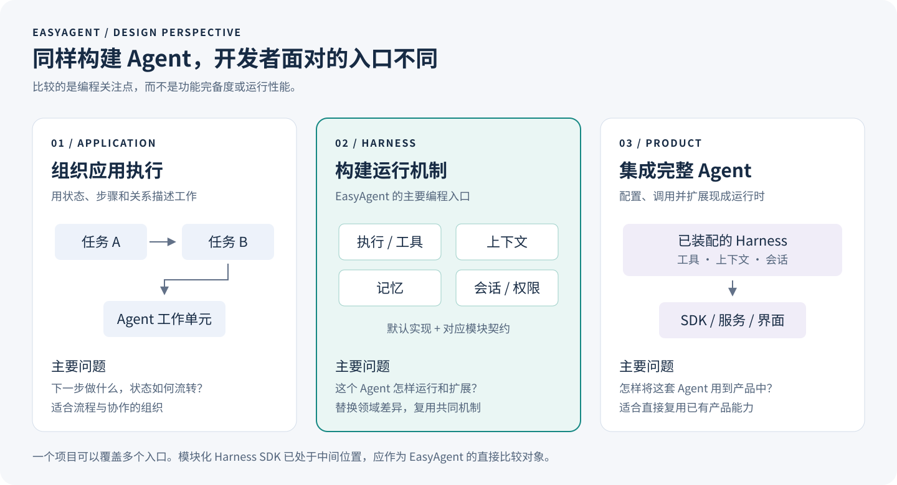
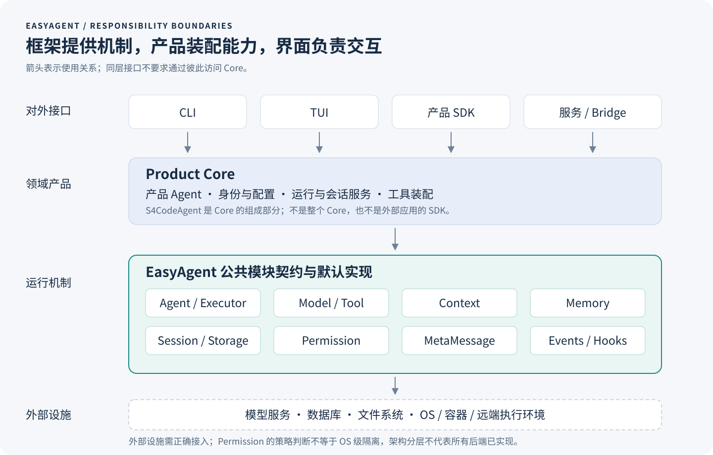

<!-- role: opening / executive summary -->
## 摘要

构建一个领域 Agent，起点往往只是模型、提示词和工具；构建一个能够持续演进的 Agent 产品，则需要处理上下文、工具生命周期、权限、动态信息、记忆、会话和交互。开发者既可以使用通用 Agent 框架组织应用，也可以基于完整 Harness 二次开发。然而，当领域需求涉及运行机制本身时，前者可能留下大量底层协作工作，后者可能要求开发者理解并调整既有产品的内部假设。

EasyAgent 选择面向 Harness 编程：将 Agent 执行、上下文、记忆、工具、权限和会话等运行机制直接作为开发者接口的组织中心。框架提供默认实现，也允许通过对应契约替换关键模块。开发者不需要先掌握整个 Harness 的实现细节，就能使用现成能力；需要定制时，则聚焦自己负责的模块及其行为约定。

本文说明这一设计的动机、核心思想和已有实现，以记忆机制、上下文组装和会话恢复为具体案例，并对照主流应用框架、完整 Harness 产品及模块化 Harness SDK。EasyAgent 的价值主张不是功能数量最多，而是让领域差异尽可能停留在相关模块中，让通用运行机制可以被重复使用。

> **核心主张：默认实现帮助开发者开始，模块契约支持开发者走出默认实现。**

本版本是一份架构与产品定位白皮书，不包含性能实验、开发效率测量或任务成功率排名。EasyAgent 的实现说明以当前 0.8.0 开发工作树为依据；第三方项目以 2026-09-07 查阅的官方资料为依据。文中的选型判断是架构分析，不是对所有版本和场景的绝对结论。

## 1. 从“使用 Agent”到“构建自己的 Harness”

<!-- role: opening / problem definition -->
### 1.1 领域化的深度，决定开发方式

若领域化只需修改提示词、添加知识库和注册工具，直接采用已有框架或成熟 Agent 产品通常是合理的选择。EasyAgent 更关注另一类需求：领域差异已经进入 Agent 的运行机制，并将随产品发展持续变化。

例如，一个科研 Agent 不仅需要“懂科研”的提示词。它可能需要按实验组织记忆，让模型主动查找旧结果；长时间等待外部计算任务；在压缩上下文时保留实验条件和证据引用；在恢复会话时识别任务的实际状态。这些需求分别触及记忆、执行、上下文和会话，而不是同一个“提示词配置项”。

运维 Agent 面临不同的约束：诊断操作和变更操作有不同权限，操作目标可能是远端环境，审批记录需要与执行状态关联。数据分析 Agent 则可能需要管理大型结果文件、数据集引用和计算资源。共享的并不是同一套产品流程，而是围绕模型运行的一组机制。

### 1.2 本文所说的 Harness

本文将 Harness 定义为模型周围的执行与状态管理系统：它将用户输入和已有状态组织成模型请求，将模型动作转换为受控工具执行，再把结果送回后续推理，同时处理取消、权限、上下文变化和会话生命周期。

Agent Loop 是其中的协调过程，但 Harness 不止一个循环。一个简短的模型—工具循环可以演示能力，真正的产品还需要明确：工具执行失败是否进入模型上下文，等待审批是否结束当前运行，取消后哪些操作仍可能完成，以及会话恢复能恢复什么、不能恢复什么。

“框架”“SDK”“Harness”并非互斥标签。框架可以内置 Harness，产品可以提供 SDK，SDK 也可以公开可替换的运行模块。本文比较的是开发者实际获得的抽象与扩展边界，而不是项目名称。



*图 1：三种开发入口解决不同问题。图中没有性能排序；各类项目可以跨越多个入口。EasyAgent 将“构建和替换运行机制”作为主要编程入口。*

## 2. 两条常见路线留下的工程成本

<!-- role: challenge / orchestration-first route -->
### 2.1 使用应用框架：自由之外，谁负责运行语义？

以编排为中心的框架擅长描述状态、执行步骤和控制关系。LangGraph 官方定位是面向长期运行、有状态 Agent 的低层编排运行时，允许确定性步骤与模型驱动步骤混合；CrewAI 以 Crews 和 Flows 组织自主协作与执行流程。因此，不能把它们描述为“只能执行预先写死的工作流”。[LangGraph 官方概览][S01]、[CrewAI 官方介绍][S02]

问题出现在抽象与需求不直接对应时。开发者想替换记忆机制，却先要确定该机制怎样更新全局状态；想改变工具结果处理，却同时要考虑节点转移、结果合并和中断恢复。这样的映射本身并非错误，但可能成为额外维护层。

另一项成本来自能力之间的连接。模型、工具、存储和事件即使都已有接口，开发者仍可能要决定它们在失败、取消、审批和恢复时怎样共同工作。组件可复用，不等于组件之间的运行语义已经被复用。某个工具有结果、会话却未保存，和会话保存了“已执行”、外部操作却未完成，是不同的故障。

EasyAgent 的回应是把这些问题直接落到 Harness 的模块边界：执行器协调请求与动作，Context 接受准备好的信息并控制预算，Memory 表达记忆机制，Session 保存和恢复显式状态。产品无需为了这些需求再设计一套与工作流状态相互映射的内部 Harness。

### 2.2 二次开发完整 Harness：开箱即用之后，如何改变机制？

成熟 Harness 的优势是已经装配好了完整运行能力。开发者能够直接使用工具、上下文管理和交互机制，通常比从零建设更快进入业务开发。困难并不是“没有功能”，而是领域需求超出既有扩展点时，修改需要深入到哪里。

配置记忆目录，不一定等同于替换记忆机制；修改压缩提示词，不一定等同于替换压缩算法；在工具前后运行 Hook，不一定等同于接管调度方式。产品 SDK、插件和 Hook 可以覆盖大量实际需求，但“扩展现有行为”和“替换行为机制”仍是不同层次的控制权。

当扩展点不能覆盖需求，开源提供了修改源码的机会，却不自动提供低成本的修改路径。领域团队可能需要理解多个内部组件、维护自己的分支，并在上游更新时重新检查兼容性。这个成本取决于具体产品的模块边界，不能由“是否开源”一项判断。

EasyAgent 的回应是将关键运行机制作为正式契约提供。默认 Agent 是这些能力的使用者和装配入口，而不是所有扩展都必须迁就的唯一产品实现。支持主流方案的意义，也不是让产品继承一切默认策略，而是给用户可用的起点和清晰的替换位置。

### 2.3 需要填补的是抽象缺口，而不是制造对立

应用编排和 Harness 定制可以共存。企业流程负责接单、准备环境、调用领域 Agent、验收及发布；领域 Agent 内部则由模型选择行动，并由 Harness 执行约束。EasyAgent 可以服务于后者，不必同时取代前者。

同样，调用完整 Agent 的程序接口与构建自己的 Agent，都是合理需求。若现成产品已经满足要求，继续复用它通常比重建更合适。EasyAgent 更适合那些把运行机制本身视为产品能力、并希望长期掌握其演进方向的团队。

## 3. EasyAgent 的核心思想：面向 Harness 编程

<!-- role: method / central idea -->
### 3.1 让领域需求直接对应运行机制

EasyAgent 将“我要改变什么机制”作为扩展入口：改变执行方式，对应执行器；改变上下文形成方式，对应 Context；接入不同记忆方案，对应 Memory；改变会话存储，对应 Session Store。框架仍有自己的类型和约定，但这些约定直接描述 Harness 的组成，而不要求所有需求先转换为图节点或角色任务。

这种设计的预期优势是修改的局部性：记忆方案变化，不应迫使用户重写模型调用；存储后端变化，不应要求重写推理循环；产品提示词变化，不应依赖修改框架默认规则的源码。它强调的是需求和代码责任的对应关系，而不是类数量或继承深度。

### 3.2 抽象共同契约，而不是固化某种实现

模块接口应容纳有意义的不同方案。对记忆而言，共同问题包括“怎样让模型理解这套记忆”“怎样读取和写入”“何时参与运行”，但答案不必都是向量检索或统一 CRUD。对上下文而言，共同责任是组织输入和控制总量，而不是替每一种信息来源规定检索方式与配额。

因此，默认实现是契约的一种实现，不是契约的定义。一个模块能更换数据库连接，只能证明后端可替换；要证明机制可替换，还要看用户能否改变该模块参与 Agent 的方式。

### 3.3 封装系统知识，但不隐藏行为责任

用户可以只使用默认模块，也可以只实现一个需要定制的模块，不必先读完整个执行器。记忆作者负责自己的数据与检索策略，工具作者负责参数和业务动作，产品作者负责目标、配置与装配。框架提供这些模块进入运行管线的公共路径。

这并不意味着用户无需理解任何底层原理。自定义记忆方案仍需理解自己的数据语义，自定义工具仍需说明副作用。框架应隐藏无关的内部实现，同时公开必要约束：何时调用、是否并发、谁关闭资源、取消如何传播、哪些状态可以恢复。完整替换执行器时，开发者也要承担相应的协调责任。

### 3.4 有默认入口，也有离开默认路径的出口

`BasicAgent` 为普通使用提供可组合入口；关键模块提供明确的替换方式。局部需求应优先通过局部接口完成，只有运行策略确实不同，才替换执行器。EasyAgent 并不要求每个用户自己编写循环，也不把“复制默认执行器再修改”当作理想的日常扩展方式。

当前实现仍处于演进中。并非每个工具调度、执行环境或权限细节都已经拥有同样细粒度的替换契约。本文强调已经明确的执行器、Context、Memory、Session 与 Storage 边界，不把目标架构画成全部完成的能力清单。

### 3.5 四个可以直接辨认的结构优势

**机制可选。** 记忆模块不强制自动检索，Context 不规定内容来源，因此“模型主动搜索”和“模块主动注入”可以有各自的实现位置，而不必将其中一种伪装成另一种。

**变化局部。** 更换 Session Store 的实现不需要重新定义 Agent Loop；更换记忆机制也不要求 Context 认识新的业务类型。框架的分工为产品提供了明确的修改落点。

**基础设施共享。** Memory 与 RAG 可以使用公共存储和 Embedding 接口，同时保留各自的领域对象。复用发生在合适的层次，不必共享同一种业务数据模型。

**产品边界清楚。** 模型、工具与模块由产品显式装配；会话恢复数据，界面处理交互。框架提供能力，但不替领域产品规定身份、界面和全部运行策略。



*图 2：EasyAgent 提供框架契约与实现；领域产品 Core 负责产品装配和规则；CLI、TUI、SDK 是平级消费者。示意中的执行环境由工具实现及外部基础设施接入，不表示现版本已实现统一的全后端沙箱接口。*

## 4. 从理念到实现：三个关键边界

<!-- role: method / memory -->
### 4.1 Memory：让机制成为模块，而不是把后端当模块

当前 `BaseMemory` 以可选的 Prompt Blocks、Tools 和 Hooks 表达一个完整记忆机制。说明让模型知道这套记忆如何使用；工具提供读取、搜索或保存行为；Hook 供确有需要的实现参与动态处理。三者均不要求某一种记录分类、向量库或检索算法。[记忆模块指南][E01]

例如，一个文件记忆实现可以提供文件说明和读写工具，让模型决定何时查找；一个外部记忆服务实现也可以提供查询工具，或选择在异步 Hook 中检索后注入信息。框架不要求两者模仿同一种存储结构。内置 `LayeredMemory` 保留既有分层方案，作为可选实现，而不是所有记忆必须遵守的内部模型。

这使扩展关注点从“如何适配框架的某种记忆数据结构”转向“我的记忆机制怎样向模型说明并参与运行”。文件记忆和外部服务在这里是可实现的扩展方向，不表示当前已随包附带这些完整方案。


*图 3：固定的是接入契约，不是检索算法。动态注入是可选路径；普通工具结果走已有工具返回路径，不需要再复制为 MetaMessage。文件方案和外部服务是扩展示意。*

### 4.2 Context 与 MetaMessage：分离内容来源和组织机制

Context 接受已准备好的 system prompt、history 和其他上下文内容，负责组装、总预算与压缩。它不自行查询 Memory、RAG、文件系统或会话数据库，也不再要求为每类来源注册专门的配额对象。[Context 与压缩指南][E02]

MetaMessage 提供动态消息注入与生命周期机制。Memory 或其他模块决定注入什么、标记什么来源、使用何种生命周期；MetaMessage 不解释来源的业务含义。这个分工允许产品改变内容生成策略，而不要求 Context 增加对新业务模块的依赖。

预算管理也体现“共同机制由框架处理”。当前 Agent 优先使用主模型返回的有效 usage 作为基线，再估算新增或移除内容的增量；缺少有效基线时回退完整本地估算。自动压缩预检、最终输入检查与用量查询遵循同一规则。这里的增量仍是估算，不是尚未发送请求的 API 实测值。

### 4.3 Session 与 Storage：恢复数据，不猜测产品装配

SessionPersistence 保存可恢复状态，`BaseSessionStore` 定义存储契约。应用先装配 Agent、模型和模块，再将会话数据恢复到这个实例，而不是让数据库记录决定实例化哪些产品类。[会话持久化指南][E03]

Storage 则进一步承担领域中立的基础设施职责。文档、向量、图存储与 Embedding 接口可以服务于 Memory 和 RAG；各自的领域 repository 负责数据转换。更换长期存储方案，不需要把存储后端继续绑定在某种记忆分类体系里。[公共存储指南][E04]

会话快照不是完整原始会话日志，恢复会话也不意味着重放或恢复全部外部副作用。界面的 checkpoint 命名、选择和回溯策略属于产品交互；底层状态保存能力可以复用。明确这些区别，比用一个“支持恢复”的标签覆盖所有语义更重要。

### 4.4 一个可读的产品装配入口

下面的示例使用当前公开接口。它展示模块装配而非完整应用：`llm`、记忆工具与会话存储由调用方提供；没有执行模型调用，也没有实现文件记忆本身。

```python
from easyagent import BasicAgent
from easyagent.context import ContextManager
from easyagent.memory import BaseMemory
from easyagent.prompting import PromptBlock, SystemPromptComposer

class DomainMemory(BaseMemory):
    def __init__(self, tools):
        self.tools = list(tools)

    def get_prompt_blocks(self, context):
        return [PromptBlock(
            "memory.domain",
            "Use the memory tools to search prior evidence when useful. "
            "Save reusable findings with their source references.",
        )]

    def get_tools(self):
        return self.tools

def build_domain_agent(llm, memory_tools, session_store):
    agent = BasicAgent("domain-agent", llm)
    agent.with_prompt(SystemPromptComposer(
        blocks=[PromptBlock("identity", "You are a domain research assistant.")],
        include_defaults=False,
    ))
    agent.with_memory(DomainMemory(memory_tools))
    agent.with_context(ContextManager(max_tokens=24_000))
    agent.with_session(session_store)
    return agent
```

这段代码的意义不在“行数少”。它明确了产品身份、记忆机制、输入预算和会话存储的责任位置。关闭默认提示词规则不等于关闭记忆模块的说明。此例没有安装压缩器，超预算时不能期待它自动总结历史；需要时应另行配置压缩实现。[公开 API 指南][E05]

## 5. 与主流 Agent 框架对比

<!-- role: evidence / comparison methodology -->
本节比较各项目的主要编程入口、已公开的能力与 EasyAgent 的相关取向，不将“文档未强调”写成“不支持”。所有项目都可能通过组合、扩展或改源码实现更多功能；差别在于开发者要接触什么契约，以及需求是否能沿正式扩展路径完成。每行最后一列是本文的架构判断，不是测量结果。

### 5.1 应用、编排与通用 Agent 开发框架

| 项目 | 主要入口与已公开能力 | 与 EasyAgent 的关键对照 |
| --- | --- | --- |
| [LangChain / LangGraph][S01] | 模型、工具与 Agent 组件；图状态、持久执行、流式和人工介入 | 适合应用与执行编排。EasyAgent 把 Harness 模块契约作为主要入口，不要求先用图描述内部机制；外层流程可以继续使用图。 |
| [CrewAI][S02] | Agent、Task、Crew、Flow；自主协作与有状态流程 | 角色与任务分工清晰。EasyAgent 优先表达一个 Agent 的运行组成，而不要求先组织成团队任务。 |
| [OpenAI Agents SDK][S03] | Agent、Runner、Tools、Handoffs、Guardrails、会话与运行状态 | 已提供循环和运行能力，并非仅做编排。应比较具体模块的替换边界，而不能声称它没有 Harness。 |
| [Google ADK][S05] | Agent 开发、模型和工具接入、调试部署与图式工作流 | 覆盖从 Agent 到应用部署的需求。EasyAgent 侧重按运行机制划分的 Python 模块装配；并不声称 ADK 只能使用 Google 模型。 |
| [Microsoft Agent Framework][S06] | Agent 与多 Agent 模式、工作流、会话状态、中间件和遥测 | 企业集成与工作流是重要组成。EasyAgent 的取向是以领域 Harness 的局部定制作为设计中心，而非取代其企业生态。 |
| [smolagents][S07] | 轻量 Agent；CodeAgent 通过代码表达工具行动，支持沙箱执行 | 它也不是图编排框架。比较重点是轻量行动模型与较完整的模块、状态和产品装配需求，不是“模型能否自主行动”。 |
| [LlamaIndex Workflows][S08] | 由事件触发的步骤、类型化事件和执行流 | 适合将应用逻辑表达为事件驱动工作流。EasyAgent 针对的是工作流内部的 Agent 运行机制；二者可处于不同层次。 |
| [Haystack][S09] | 组件与 Pipeline；Agent 管理工具循环、共享状态、流式和人工审核 | 检索与组件复用具有直接价值。EasyAgent 不替代检索 Pipeline，而允许检索工具或模块接入自身 Harness。 |

Microsoft 官方将 Agent Framework 描述为 AutoGen 与 Semantic Kernel 的后续方向，因此这里按这一谱系比较，而不是把旧项目当成静止不变的竞争对象。[Microsoft 官方概览][S06]

OpenAI Agents SDK 的 Sandbox Agent 已公开文件、Shell、记忆和压缩等能力组合，开发者也能切换执行环境。因此，EasyAgent 的差异不能建立在“其他 SDK 没有环境、记忆或压缩”之上，而应落在契约粒度、实现替换路径和产品独立性上。[Sandbox Agents][S04]

### 5.2 面对这些框架，EasyAgent 补什么

EasyAgent 首先补的是一套以 Harness 机制为中心的组织方式：用户可以直接讨论记忆、上下文和会话接口，而不是每次重新决定这些概念怎样映射到应用状态。其次，它将默认运行与模块装配放在一起，避免只交给用户孤立组件。最后，它提供从默认实现到自定义机制的连续路径，降低进入整个系统内部的必要性。

这些是设计层面的价值，不代表其他项目无法实现同样目标。团队若已深度依赖某个生态，应同时评估复用既有部署、观测和工作流设施的收益。为保持产品可控而引入 EasyAgent，与为追求统一技术栈而沿用原框架，都是可以成立的工程选择。

## 6. 与完整 Harness 产品对比

<!-- role: evidence / product harnesses -->
### 6.1 从“驱动已有 Agent”到“构建自己的机制”

| 项目或产品接口 | 已公开的集成方式与优势 | 深度领域化时应检查什么 |
| --- | --- | --- |
| [Codex App Server][S10] | 通过结构化协议集成认证、会话、审批和流式事件，可构建自己的客户端 | 需要的是运行 Codex，还是替换其内部机制？产品操作接口不自动等同于任意模块替换接口。 |
| [Claude Code / Claude Agent SDK][S11] | 复用 Claude Code 的工具、Agent Loop 和上下文管理；提供提示词、工具、Hook 等扩展 | 需求是否能通过正式扩展点完成？修改默认行为和接管机制是不同层次，但不能因此说 SDK 不支持定制。 |
| [Gemini CLI][S12] | 开源终端 Agent，提供工具及扩展能力，可结合其源码与文档构建集成 | 终端与产品配置假设是否符合目标领域？若要改核心机制，需核查当前版本的公共边界。 |
| [OpenCode SDK][S13] | 类型化 JS/TS 客户端，程序化访问服务、会话、文件和事件 | 服务客户端擅长集成已有运行时；客户端可操作的范围与内部模块可替换范围需要分别评估。 |
| [Aider][S14] | 面向代码库的交互式编辑，文件上下文与 Git 工作方式紧密结合 | 若目标不是代码编辑，需要明确哪些交互和状态假设仍适用。不能把它的产品目标视为一般框架缺陷。 |

对这类产品，EasyAgent 的吸引力不是“也能执行任务”，而是开发者能保留自己对 Harness 机制的定义权。工具、记忆、上下文和会话的公共契约，不应依赖某个终端产品的命令、目录习惯或完成任务方式。

一个产品可以基于 EasyAgent 构建自己的 Core，再向外提供 CLI、TUI、SDK 和无界面服务。外部程序使用产品 SDK；产品的内部界面与 SDK 则共同消费 Core。这样的分层使“产品可被调用”与“产品依赖什么框架”分开，也避免把 EasyAgent 的内部类型直接变成所有外部用户必须理解的 API。

### 6.2 S4Code：框架与产品分离的具体落点

S4Code 在这个工作空间中是基于 EasyAgent 的具体 Coding Agent 产品。`S4CodeAgent` 属于产品 Core 的一个组成部分，而不是整个 Core；配置、运行、会话和工具装配共同形成产品核心。Python SDK、CLI、Textual TUI 与桥接服务是产品核心的消费者，Ink TUI 经桥接访问同一 Core。

这一案例说明 EasyAgent 可以承载产品构建，但不将 S4Code 的全部行为下沉为框架规则。提示词身份、斜杠命令、界面 checkpoint 交互以及主题等由产品相应层负责；可复用的模型、工具、上下文和状态能力属于框架。S4Code 是具体案例，不是多个领域迁移效果已经被测量的证据。[产品边界说明][E06]

## 7. 与模块化 Harness SDK 的正面对照

<!-- role: evidence / closest alternatives -->
最接近 EasyAgent 的并不只有编排框架，也包括已经将 Harness 做成可复用库的项目。下面这些方案承认并解决了相同问题的一部分。将它们忽略，或仅称为“不能扩展的成品”，会削弱比较的可信度。

| 项目 | 官方公开的模块化方式 | EasyAgent 应坚持比较的具体边界 |
| --- | --- | --- |
| [Deep Agents][S15] | 基于 LangChain / LangGraph 的 Harness；文件系统、上下文、子 Agent、人工介入及可接入后端 | 不以“有没有 Harness”为差别；比较替换完整机制时依赖的接口，以及开发者需掌握的运行模型。 |
| [Pydantic AI Harness][S16] | 以 Capability 组合指令、工具与行为；完整 Coder 也可拆成组成能力 | 模块化本身不是 EasyAgent 独有。重点比较 Memory、Context、Session 的独立领域契约，与统一能力组合方式各自的使用成本。 |
| [OpenHands Software Agent SDK][S17] | Agent、Conversation、Tools、Workspace、Condenser、Security；支持本地及远程运行 | 已有相当直接的运行时抽象。应比较契约、状态责任和产品装配方式，不笼统声称它只有产品、没有框架。 |
| [Cline SDK][S18] | 将模型层、无状态 Agent 循环和有状态 Core 分层，公开运行与扩展边界 | 同样体现产品运行时可复用化。EasyAgent 的特色需由自己的模块语义和扩展示例呈现，而非仅凭“Core 解耦”。 |

EasyAgent 的设计辨识度来自一组明确选择：将记忆机制与存储后端分开，将动态注入与内容来源分开，将上下文组装与检索策略分开，将会话数据与产品实例装配分开，并将执行器作为可替换的协调点。这些选择一起形成面向 Harness 的编程模型。

本文将它们称为 EasyAgent 的设计特色与创新组合，而不主张首次提出模块化、依赖反转或 Harness SDK。OpenHands 已有专门讨论可组合生产 Agent 架构的论文；EasyAgent 的比较重点则是各机制的独立契约及其组合方式。[OpenHands SDK 论文][S19]

## 8. 优势如何落到领域需求上

<!-- role: advantage / concrete use cases -->
### 8.1 从分层记忆换到证据型记忆

需求不是换一个向量库，而是改变模型使用知识的方式：只有需要证据时才搜索；结果携带来源；保存时记录可复用结论。EasyAgent 的 `BaseMemory` 不强制统一记忆分类或 CRUD，因此可以由该实现提供相应说明和工具，不要求 Context 配合新增检索来源。

这个需求的修改落点是记忆实现及其工具，而不是为 Context 增加一种来源，或在执行器中增加一条记忆专用分支。

### 8.2 从聊天摘要换到领域保留策略

科研记录可能要保留实验条件，运维记录可能要保留资源标识与变更结果。通过压缩器或 Context 契约，产品可以明确这些规则，而不必把每一种领域规则硬编码进默认执行器。

替换压缩策略仍需保证输入输出有效，不能破坏待处理工具调用与结果关系，也不能假定摘要包含全部原始记录。模块化降低的是接入范围，不是免除实现者对自身行为的责任。

### 8.3 从本地对话扩展到自己的产品服务

产品可以将 Core 能力提供给不同界面，并通过自己的 SDK 为外部应用提供稳定入口。S4Code 的结构体现了这种分工。框架不需要知道某次查询来自命令行还是界面；界面也不需要独立维护另一套模型和记忆装配。

远程任务、受控计算环境和企业审批同样是有价值的扩展方向，但它们需要相应的工具实现、执行基础设施与产品集成。现版本没有承诺一个配置项即可覆盖所有云端执行环境、故障恢复语义或 OS 级隔离。

### 8.4 知识门槛降低，来自稳定的责任边界

默认用户只需知道如何组合模块；扩展用户需要知道自己模块的契约；运行时专家才需要深入协调策略。理想情况下，开发者根据需要逐层增加控制，而不必一开始就掌握整个 Harness。

这也是 EasyAgent 最重要的用户承诺：使用默认实现时能够开始工作，默认实现不合适时仍有正式的扩展路径。框架所封装的不只是代码，也包括模块如何参与运行的知识。

## 9. 当前能力、设计边界与选型

<!-- role: limitation / implementation status -->
### 9.1 不把设计图当作完成清单

| 能力 | 当前依据与边界 |
| --- | --- |
| Agent 与执行器 | 已有 `BasicAgent` 和可替换执行器接口，同步、异步及流式入口；整体替换执行器需履行协调责任。 |
| Memory | 已有机制级契约和内置 `LayeredMemory`；文件记忆及其他服务是可接入方向，不在本文中宣称已有完整实现。 |
| Context / MetaMessage | 已分离组装、总预算、压缩与动态注入；主模型 usage 基线用于计数，失效时回退估算。 |
| Session / Storage | 已有显式装配后恢复、Store 契约和共享存储接口；快照不是完整日志，不保证外部操作自动恢复。 |
| Tool / Permission / MCP / Skill | 已提供相关能力与公开入口；权限判断不是 OS 沙箱，工具仍需正确处理资源、副作用和取消。 |
| Environment / 调度细粒度替换 | 现有工具和运行设施可供使用；统一执行环境接口、任意后端无缝替换等不能当成全部已完成。 |
| 产品案例与成熟度 | S4Code 提供具体集成案例；本版没有跨领域对照实验或生产规模基准。 |

以上状态来自当前公开 API、指南和相应模块实现，不代表兼容所有第三方环境。它们也不应被解释为“装上框架就自动达到工业级”。安全部署、领域验收、运营监控与外部系统恢复仍然是完整产品的工作。[框架 API][E05]、[模块重构记录][E07]

### 9.2 什么时候选择 EasyAgent

当团队预计会持续调整记忆、上下文、工具或会话机制，希望这些能力通过公开接口被控制，而且不希望维护完整产品的源码分支时，EasyAgent 是值得考虑的构建底座。它尤其适合将运行方式视为产品差异的一部分，而不是只替换界面或提示词的场景。

若重点是确定性业务流程、已有生态集成或企业级编排设施，现成工作流框架可能更直接；若目标与成熟 Coding Agent 高度一致，产品 SDK 可能更省事；若需要成熟的远程工作空间和其他既有运行设施，则应与 OpenHands 等方案仔细对照。需要单一工具调用循环的简单应用，也不必为了“架构完整”安装全部模块。

选择 EasyAgent，不应出于其他项目被人为描述得不够灵活，而应出于本项目的公共契约与自己的领域需求确实匹配。

## 10. 结语：把构建 Harness 变成可掌握的开发工作

<!-- role: conclusion / takeaway -->
EasyAgent 面向的不是“再写一个调用模型的循环”，而是围绕循环形成一套开发者可以理解、使用和替换的运行机制。通用框架提供了强大的应用组织能力，成熟 Harness 提供了完整的 Agent 工作能力；EasyAgent 将自己的设计中心放在构建领域 Harness 的公共模块契约上。

它的核心思想可以归结为三句话：面向运行机制，而不强制面向编排概念；复用默认实现，而不把默认实现固化为唯一机制；让开发者负责领域差异，让框架承担可复用的系统协作。

**让使用默认能力的人不必成为 Harness 专家，让需要改变机制的人不必重建整个 Harness。** 这是 EasyAgent 的产品方向，也是本白皮书所要表达的价值。

### 阅读与版本说明

本文不提供竞品功能打分、性能雷达图、开发成本百分比或“首次／唯一”结论。官方资料证明的是项目公开的能力与接口；架构判断说明的是这些能力与目标需求的关系。未来若发布量化结论，应另行说明版本、环境与验证方法。

配套的 [来源与对比口径](comparison-sources.md) 记录第三方资料及 EasyAgent 的实现依据；[编辑审校记录](editorial-review.md) 记录段落职责、主张—证据对应关系和本版打磨过程。两者属于编辑附件，正文可独立阅读。

## 参考资料

以下均为项目官方资料或项目作者论文，核对日期为 2026-09-07。正文中的链接直接指向支持相应描述的页面；本列表便于转发 PDF 时保留完整引用索引。

1. [LangGraph overview — LangChain Docs][S01]
2. [Introduction — CrewAI][S02]
3. [Agents SDK — OpenAI][S03]
4. [Sandbox Agents — OpenAI][S04]
5. [Agent Development Kit — Google ADK][S05]
6. [Microsoft Agent Framework Overview — Microsoft Learn][S06]
7. [smolagents — Hugging Face][S07]
8. [Workflows Introduction — LlamaIndex][S08]
9. [Agents — Haystack Documentation][S09]
10. [Codex App Server — ChatGPT Learn][S10]
11. [Agent SDK Overview — Claude Code Docs][S11]
12. [Gemini CLI — Official Repository][S12]
13. [SDK — OpenCode][S13]
14. [Usage — Aider][S14]
15. [Deep Agents Overview — LangChain Docs][S15]
16. [Pydantic AI Harness — Pydantic Docs][S16]
17. [SDK Package Architecture — OpenHands][S17]
18. [Cline SDK Architecture — Official Repository][S18]
19. [The OpenHands Software Agent SDK: A Composable and Extensible Foundation for Production Agents][S19]

[S01]: https://docs.langchain.com/oss/python/langgraph/overview
[S02]: https://docs.crewai.com/en/introduction
[S03]: https://developers.openai.com/api/docs/guides/agents
[S04]: https://developers.openai.com/api/docs/guides/agents/sandboxes
[S05]: https://adk.dev/
[S06]: https://learn.microsoft.com/en-us/agent-framework/overview/
[S07]: https://huggingface.co/docs/smolagents/index
[S08]: https://developers.llamaindex.ai/python/llamaagents/workflows/
[S09]: https://docs.haystack.deepset.ai/docs/agents
[S10]: https://learn.chatgpt.com/docs/app-server
[S11]: https://code.claude.com/docs/en/agent-sdk/overview
[S12]: https://github.com/google-gemini/gemini-cli
[S13]: https://opencode.ai/docs/sdk/
[S14]: https://aider.chat/docs/usage.html
[S15]: https://docs.langchain.com/oss/python/deepagents/overview
[S16]: https://pydantic.dev/docs/ai/harness/
[S17]: https://docs.openhands.dev/sdk/arch/sdk
[S18]: https://github.com/cline/cline/blob/main/sdk/ARCHITECTURE.md
[S19]: https://arxiv.org/abs/2511.03690
[E01]: ../memory_system_guide.md
[E02]: ../context_and_compaction_guide.md
[E03]: ../session_restore_persistence_guide.md
[E04]: ../storage_guide.md
[E05]: ../framework_api.md
[E06]: comparison-sources.md#s4code-产品案例
[E07]: ../module_refactor_progress.md
